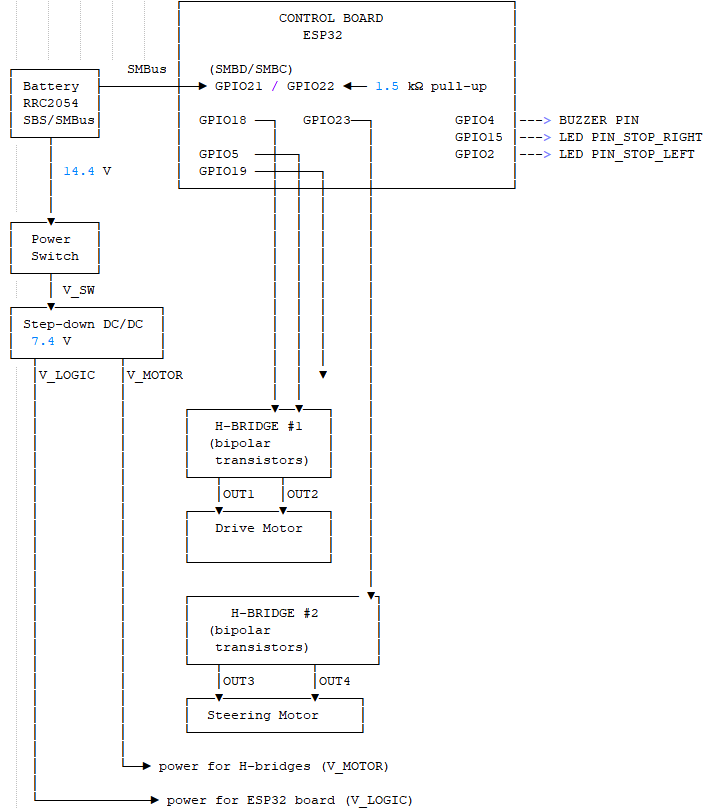
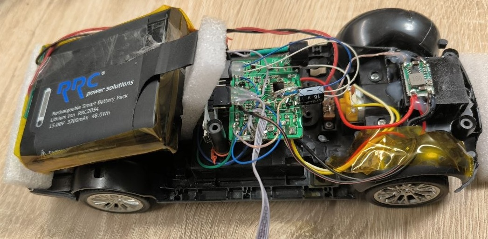
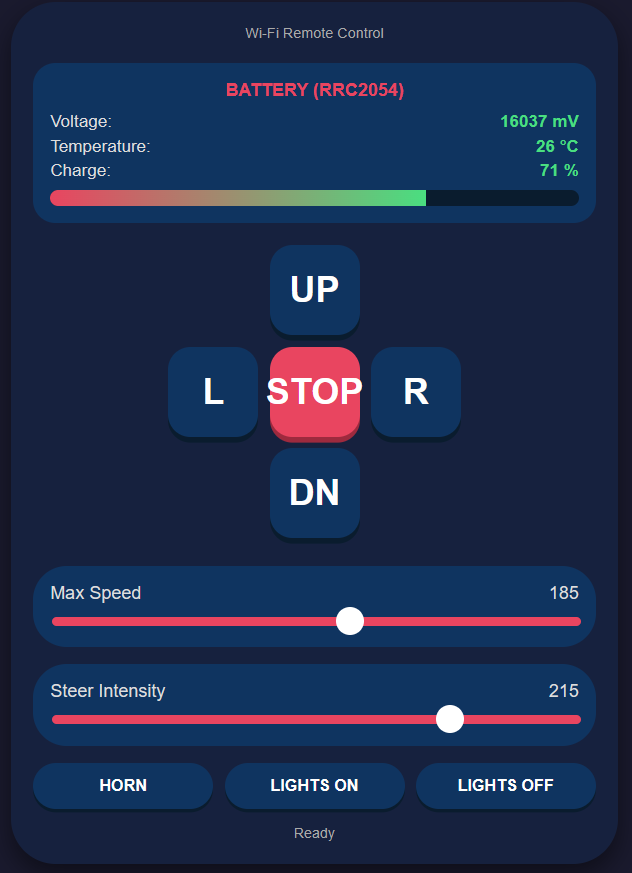

# ESP32 Toy Car Control System

Firmware for controlling an electric vehicle  based on ESP32.
The device creates its own Wi-Fi access point with a web interface, controls motors via PWM, reads RRC2054 battery telemetry using the SMBus protocol, and supports OTA firmware updates over the air

## 🛠️ Toolkit

- PlatformIO (Core 6.1.11, Home 3.4.4)
- VS Code + PlatformIO IDE extension
- Framework: Arduino (for ESP32)
- Board: ESP32_DevKitC_V4

### Build and upload

```bash
# Build
pio run

# Upload via USB
pio run -t upload

# Port monitor (115200 baud)
pio device monitor
```

### 🔄 OTA update

1. Connect to Wi-Fi ESP32_Car (see password below).
2. Open in the browser http://192.168.4.1/update
3. Select the .bin file (is built automatically in .pio/build/<env>/firmware.bin) and upload it.
4. ESP32 will reboot automatically.

## Connecting to Wi-Fi

ESP32 operates in access point (AP) mode:

| Parameter | Value |
|---|---|
| SSID | ESP32_Car |
| Password | 12345678 |
| ESP32 IP address | 192.168.4.1 |
| Web server port | 80 |

After connecting, open the following in your browser:

| URL | Purpose |
|---|---|
| http://192.168.4.1/ | Main control interface |
| http://192.168.4.1/battery | JSON with battery data |
| http://192.168.4.1/update | OTA update page |

## Pinout

### Motors (PWM, 20 kHz, 8 bit)

| Function | GPIO | Note |
|---|---|---|
| Forward | 18 | PWM channel 0 (drive) |
| Reverse | 5 | PWM channel 0 (drive) |
| Left | 19 | PWM channel 1 (steer) |
| Right | 23 | PWM channel 1 (steer) |

### Light and sound

| Function | GPIO |
|---|---|
| Left brake light | 2 |
| Right brake light | 15 |
| Beeper (horn) | 4 |

### RRC2054 battery (SMBus / I2C)

| Line | GPIO | ESP32 Board |
|---|---|---|
| SMBD (SDA) | 21 | D21 |
| SMBC (SCL) | 22 | D22 |
| Device address | 0x0B | standard SBS |
| Pull-up | external, 1.5 kΩ | to both lines to +3.3 V |
| Bus frequency | 100 kHz | Wire.setClock(100000) |

External 1.5 kΩ pull-ups are mandatory — without them, SMBus communication with the battery will be unstable or will not work at all.

## Hardware






## Control

### Web interface



- D-pad (UP / DOWN / L / R / STOP) — movement and rotation.
- Sliders:
  - Max Speed — target speed (100–250)
  - Steer Intensity — steering intensity (100–250)
- Buttons: HORN, LIGHTS ON, LIGHTS OFF.
- Battery panel: voltage, temperature, state of charge (SOC) in real time.
 
## Safety

The firmware runs the safetyTask task (on core 1), which automatically performs an emergency stop and beeps if:

- there are no Wi-Fi clients connected to the ESP32, or
- more than 30 seconds have passed since the last command.

This protects the vehicle from "running away" when communication with the remote control is lost.

## Project structure

```
.
├── platformio.ini
├── src/
│   └── main.cpp           # firmware (everything in one file)
├── include/
├── lib/
├── test/
└── README.md
```

### Main firmware components

| Function / task | Purpose |
|---|---|
| initPWM() | PWM channel configuration (20 kHz, 8 bits) |
| moveForward() / moveBackward() | Drive control |
| turnLeft() / turnRight() / straightWheels() | Steering control |
| softStartForward() / softStartBackward() | Smooth acceleration (40 steps) |
| allOff() | Complete shutdown of everything |
| handleCmd() | Handling HTTP commands |
| handleBattery() | JSON with battery telemetry |
| smbusReadWord() | Low-level SMBus word reading |
| batteryTask() | FreeRTOS battery polling task (core 0, 2 s) |
| safetyTask() | FreeRTOS emergency stop task (core 1, 5 s) |

## Useful links

- PlatformIO + ESP32: https://docs.platformio.org/en/latest/platforms/espressif32.html
- SBS — Smart Battery System Specification: https://www.sbs-forum.org/
- RRC2054 datasheet (RRC power solutions): https://www.rrc-ps.com/
- ESP32 Arduino Core — WebServer: https://github.com/espressif/arduino-esp32/tree/master/libraries/WebServer

